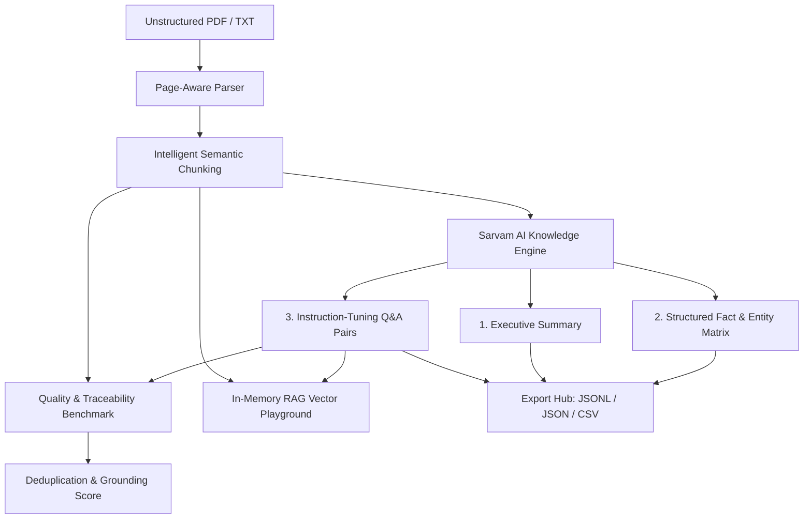

# LLM Knowledge Pipeline

An AI-powered Knowledge Engineering Platform that transforms unstructured documents (PDFs, technical papers, manuals) into structured, validated, AI-ready knowledge datasets and interactive RAG benchmarks using **Sarvam AI**.

---

## 🚀 Quickstart

### 1. Configure Your Sarvam API Key
Edit `.env` (or supply the key directly in the web UI settings):
```env
SARVAM_API_KEY=your_actual_sarvam_api_key_here
SARVAM_MODEL=sarvam-105b
SARVAM_API_URL=https://api.sarvam.ai/v1/chat/completions
```

### 2. Launch the Application
Start the server:
```powershell
python server.py
```
Open your browser at:
👉 **`http://127.0.0.1:8000`**

---

## 🛠️ Architecture & Pipeline Lifecycle



### Core Pipeline Components:
1. **Document Ingestion (`pipeline.py`)**: Page-level extraction from PDFs and text files with token and character counters.
2. **Context-Aware Semantic Chunking**: Respects paragraph and sentence boundaries, avoiding fragmentation. Each chunk receives a permanent ID (`CHK-001`, `CHK-002`) and page citation.
3. **Sarvam AI Knowledge Distillation**: Formatted JSON prompting with Sarvam LLMs (`sarvam-105b`, `sarvam-30b`, `sarvam-2b`).
4. **Quality & Deduplication Engine**: Jaccard similarity to detect duplicate chunk pairs and token-level grounding verification.
5. **Interactive RAG Playground**: Real-time vector retrieval and grounded question answering citing source chunks.
6. **Multi-Format Export**:
   - `.jsonl`: Ready for instruction fine-tuning (Alpaca / Unsloth format).
   - `.json`: Unified knowledge graph for vector database indexing.
   - `.csv`: Tabular format for human inspection and auditing.

---

## 📡 API Endpoints

- `GET /` — Serves the dark-mode glassmorphic web dashboard.
- `GET /api/status` — Checks if Sarvam API key is active.
- `POST /api/sample` — 1-click end-to-end demo on a pre-packaged technical paper.
- `POST /api/process` — Ingests uploaded PDF/TXT, executes chunking, synthesis, and evaluation.
- `POST /api/rag` — Executes semantic retrieval and grounded Sarvam LLM answers.

